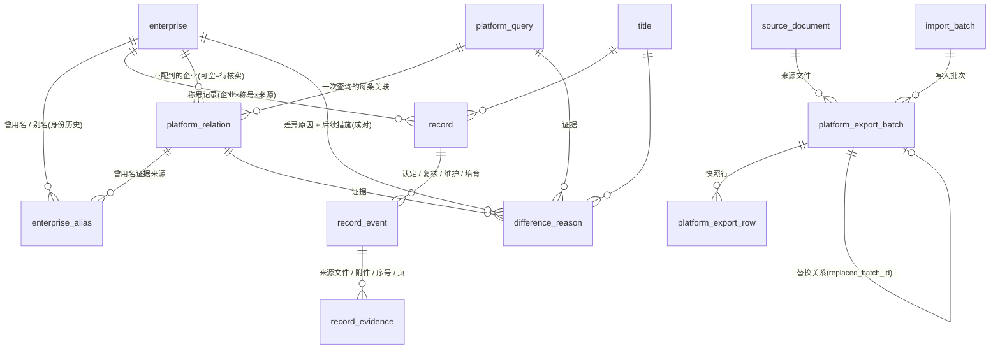

# 名录生命周期模型:公布历史、平台现状与解释证据三线分离

2026-10-16 · 状态:接受(RL-01) · 契约原文 [`docs/roster-lifecycle-contract.md`](../roster-lifecycle-contract.md)

本 ADR 冻结后续全部名录票共同遵守的领域模型:**一家企业**跨三个称号的**身份与历史**、
经信局**公布文件**给出的权威认定/复核事实、工信部**导出表**在采集时点的**平台现状**、
以及两个平台**接口**返回的**关系证据与差异解释**。三者分开存储、分开查询,互不覆盖。

它**只产出契约、最小 schema 与验收样例**;不导入数据、不改正式库、不改页面、不做模糊匹配。
实现落在既有票集(#1–#11、#13)上,见 §8。

---

## 1. 概念 ER 图

读法:
- **上半是权威历史**(公布文件 → `record` → `record_event` → `record_evidence`);
- **左下是证据**(`platform_query` → `platform_relation`,`difference_reason` 引用它,
  并可反哺 `enterprise_alias`);
- **右下是采集时点现状**(`platform_export_batch` → `platform_export_row`);
- `import_batch` 是**跨行写入的统一批次身份**(幂等键在这里)。

---

## 2. 关键唯一键 / 幂等键,与为什么

| 表 | 唯一键 / 幂等键 | 为什么 |
|---|---|---|
| `enterprise`(既有) | `uscc_norm`(UQ,可空) | 统代优先身份;空值归并交给 `name_norm`(既有决策,不改) |
| `record`(既有) | `(enterprise_id, title_code, source)` | 记录 = 企业×称号×来源(既有决策,不改) |
| `enterprise_alias` | `(enterprise_id, name_norm, source_kind, source_ref_id)` | 同一企业同一别名同一**来源行**只有一条;不同来源行**各自成条**(逐条留证)。`source_ref_id` 用 `0` 表「无引用」而非 NULL —— SQLite 把 NULL 视为互不相等,用 NULL 会漏掉重复 |
| `platform_query` | `(interface, query_key, rdjb, queried_at)` | 同接口+同键+**同 `rdjb`**+**同一时点**=同一次查询(重放幂等);**`rdjb` 必须进键** —— 实测同一 USCC 下 `rdjb=3` 返回 6 条而 `rdjb=1`/`rdjb=2` 各返回 0 条,是三次不同查询 |
| `platform_relation` | `(query_id, sequence_no)` | 关系身份 = 「哪次查询的第几条」;**同信用代码的多条关联必须逐条保留**(实测 `businessList` `rdjb=3` 返回 6 条),所以**不按企业/信用代码去重** |
| `difference_reason` | `(enterprise_id, title_code, direction, recorded_at)` | 含时点 ⇒ **旧解释不丢**,新解释成新行;当前解释 = 最新 `recorded_at` |
| `platform_export_batch` | `(title_code, year, sha256)` | **同文件重放幂等**(内容哈希);换文件⇒哈希变⇒**新版本**,用 `replaced_batch_id` 记替换关系,两版并存 |
| `platform_export_row` | `(batch_id, source_row_no)` | 同批内源行号唯一 ⇒ 重放不重复落行 |
| `import_batch` | `idempotency_key`(UQ) | **统一写入的幂等键**:同一来源重复调用不重复写企业/事件 |

**为什么幂等键要落在库层面**(而不是应用层「先查后写」):应用层先查后写在并发下是竞态;
唯一索引让「重复」变成一个**数据库拒绝的动作**,重放天然安全。既有 `stored_file_part` /
`ocr_result` 已是这个范式,本契约沿用。

---

## 3. 历史 / 当前数据边界

| 问题 | 权威 | 表 |
|---|---|---|
| 拿过哪些称号,哪年哪批认定/复核,出处第几页 | **公布文件** | `record` / `record_event` / `record_evidence` |
| 某年某天平台现状如何 | **采集时点快照** | `platform_export_batch` / `platform_export_row` |
| 为什么某条是差异,依据是什么 | **接口证据** | `platform_query` / `platform_relation` / `difference_reason` |

- 平台快照**只作对照,不改写历史**:公布事件不因平台缺失而删除,也不因平台出现而新增。
- 两者**分开存储、分开查询**:`platform_export_*` 与 `record*` 不互相 join 出「历史事实」。
- **「仅由历史平台导出引入、从未出现在任何公布名单」的企业从当前总表移除**的判定
  (**派生,不落列**):该企业**没有 jxj 来源的认定/复核事件**,只出现在导出快照 ⇒
  当它**不在最新快照**里就从当前总表移除(`rosterState = removed_platform_only`);
  但**企业行与公布历史保留**(官方历史不能因平台变化被删)。

---

## 4. 生命周期语义

1. **首次认定** = 该(企业 × 称号)下**最早的 `award` 事件**年份(以公布文件为准)。
2. **复核通过不算新的首次认定**。
3. **复核未通过后再次获批也不重置首次认定** —— 首次认定仍是最早那条 `award`。
4. **复核锚点** = 最近一次「授予/延续有效资格」的事件年份
   (`max(decided_year ?? year)`,对 `award` 与 `reviewOutcome='passed'` 取最大);
   **下一次到期 = 锚点 + 3**。重新获批**刷新锚点**但不改首次认定。
5. **未通过的复核不再进入当前有效资格的复核队列**。
6. `nurture`(入库培育)**不构成称号**,不参与首次认定 / 复核清单。
7. **`decided_year` 是必需的补充**:既有 `record_event.year` 对复核事件记的是**被复核的原认定年份**
   (GLOSSARY「复核」),表达不出「结论发生在哪一年」,而锚点要的是结论年份。
   来源给不出时**留空**,锚点退回 `year` 并**标待核** —— **不猜**。

**实测样例(平台关系行可佐证结论年份)**:USCC `91330211255994457P` 的关联
`SQ332025060392166` 是 `sblx=复核`、`whpc=2025-1`、认定批次 `第四批`(第四批 → 2022)。
即 **2022 认定 → 2025 复核**,与「三年复核」口径吻合;此关联行可作 #9 复核清单的样例。
对应 `record_event`:`eventType='review'`、`year=2022`(被复核年份)、`decided_year=2025`(结论年份)。
**注意**:`sblx=复核` 只说「发生过复核」,**没有**说结论;所以 `review_outcome` 仍为 NULL(待核),
不能因「有复核关联行」就猜成通过。

---

## 5. 迁移 / 回填方案与不确定记录边界

**迁移(本票已落)**:`db/migrations/0007_premium_sinister_six.sql`,**纯增量** ——
只 `CREATE TABLE` / `CREATE INDEX` 与新表,加上 `record_event` 两个**可空**列
(`review_outcome` / `decided_year`)。**不改名、不删除、不改既有列语义**,既有 525 个测试
的基线表现不变(见 §9)。

**现有 `record` / `record_event` / `record_evidence` 如何演进**:

- **不动**。它们仍是公布历史的权威载体。新增列提供缺的能力(复核结论、结论年份),
  既有行全部为 NULL —— 「未知」而不是「猜出来的通过」。
- 平台相关的一切**进新表**,不进 `record*`。这一步正是为了避免「把平台现状混进历史」。

**不确定记录的边界**:

| 情况 | 落点 | 绝不做什么 |
|---|---|---|
| 平台别名证据来源未给出生效时间 | `enterprise_alias.valid_from = NULL` | 不推测生效时间 |
| 平台关系无法归属 | `platform_relation.enterprise_id = NULL`、`verification_status='pending'` | 不自动合并同名多主体 |
| 迁入证据不足 | `difference_reason.moved_in_* = NULL`、`status='needs_review'` | 不猜原城市/称号/年份/批次 |
| 复核结论未知 | `record_event.review_outcome = NULL` | 不猜成「通过」 |
| 结论年份未知 | `record_event.decided_year = NULL`、锚点标待核 | 不用被复核年份冒充结论年份 |
| 来源给不出页码/时间 | NULL(既有 `record_evidence.page` 同一口径) | 空值优于错误值 |

**回填**:已交付的票(含 RL-12 的清理入库)在 RL-11 的写入 API 就位后,把结果经该 API
重放写入(幂等键保证可重放);**在 API 就位前,不把直写 SQLite 描述成已统一的流程**。

---

## 6. API 责任边界

**读(可发现、不鉴权)**:
- RL-04 企业总表 / 企业详情 / 差异与解释;RL-05 快照与版本;RL-08 首次认定;
- RL-09 复核清单;RL-10 出处页码与预览;RL-03 平台查询证据。

**写(鉴权,`NUXT_API_TOKEN` / MCP token)**:
- **RL-11** 统一导入批次 API(`preflight` + `commit`,幂等键、逐项结果、来源身份)与 MCP 写入 tool。

**软件提供什么 / 不提供什么**:

- **提供**:证据查看、匹配确认、数据回填、查询。
- **不提供**:**模糊推断 / 原因自动猜测引擎**。归属必须能指回一条可读依据
  (`match_basis ∈ {uscc, alias, manual, none}`);歧义 ⇒ `pending`(待核实),
  由代理/人在证据上判断并回填,不由程序「猜」。

---

## 7. 已验证事实 vs 需人工确认

**已验证(有来源、可复现,可直接采信)**:

- 三张工信部导出表的行数列数、来源文件身份(SPEC 已核对)。
- 小巨人工作簿:单工作表、511 条有名称数据、批次现有第 1–7 批、年份=2018+批次序号、
  只读 A:J;`91330211316904639T` 在第 2 批与第 6 批各出现一次(SPEC 已核对)。
- **`91330211255994457P` 的平台真实响应已取回并核实**
  (依据 `/Users/mang/Workfile/宁波/专精特新/20261013/orchestration-notes/04-EVIDENCE-91330211255994457P.md`;
  原始响应与凭证**不进仓库**):
  - `businessList` `rdjb=3` 返回 **6 条**关联,`rdjb=1`/`rdjb=2` 各返回 **0 条**(请求成功、会话有效 ⇒ 真实 `no_record`);
    `queryList` 返回 **2 条**。⇒ 一 USCC 多关联确实存在,必须逐条保留。
  - **平台没有独立「曾用名」列**:6 条里 2 条 `qymc=宁波上航测绘有限公司`、
    4 条 `qymc=宁波上航测绘股份有限公司`;逐字段比对后**唯一与名称有关的差异字段就是 `qymc`**
    ⇒ 曾用名由**历史关联行本身**承载。
  - 关联行可用字段(已核实):`id` / `qymc` / `tyshxydm` / `szsfmc` / `cszt` / `whpc` /
    `sblx` / `sqsj` / `personuuid`(列头为认定批次);`queryList` 另有 `year`。
  - **失败 ≠ 无记录**:会话过期时两接口回 HTTP 200 + `{"statusCode":"301","message":"登录超时,请重新登录"}`。
  - `SQ332025060392166`:`sblx=复核`、`whpc=2025-1`、认定批次 `第四批`(→2022)⇒ **2022 认定 → 2025 复核**。
- 复核案例:2021 认定 → 2024 未通过 → 2025 再获批(用户给出)。

**上述证据的落地形态**:契约 §1.3 的 `rdjb` 进唯一键、§1.4 的平台字段映射、
§5.1 的「同 USCC 下 `qymc` 不同 ⇒ 曾用名证据」规则、§5.2 的归并规则,都是照这份证据写的。

**需人工确认(契约先把落点备好,不填)**:

- 各企业曾用名的**生效/失效时间** —— 来源未给 ⇒ 留空。
- 迁移企业(迁入)的**原城市/称号/年份/批次** —— 证据不足 ⇒ 留空待核。
- 无法归属的平台关系 —— `pending`,由人工在证据上确认后回填统代与曾用名。
- 每条差异的**原因**是否能被证据支持 —— 支持不了 ⇒ `needs_review`,不用猜测填成注销/迁入。
- 复核事件的**结论年份**(`decided_year`)—— 来源未明确 ⇒ 留空,锚点标待核。

---

## 8. 实现切片映射(不新建 issue)

本契约的切片**全部映射到已存在的票**(父代理已固定 #1–#11、#13),**不新建 GitHub issue**:

| 切片(≤M) | 落点票 | 交付 |
|---|---|---|
| 最小 schema 与迁移 | **#1 RL-01**(本票) | 表/列/迁移/验收样例 + 本 ADR + 契约 |
| 导入经信局小巨人工作簿(多批次保事件) | **#2 RL-02** | 511 行入库,同代码多批次保留 |
| 平台双接口关系与别名证据 | **#3 RL-03** | `platform_query` / `platform_relation` 读写与多关联保留 |
| 跨称号去重企业总表 + 差异原因/措施 | **#4 RL-04** | `GET /api/roster/*` 读模型与视图 |
| 三张导出表年度快照 | **#5 RL-05** | `platform_export_batch` / `_row` 导入与版本比较 |
| 缺信用代码联网补查 | **#6 RL-06** | 证据补查并回填(经 #11 写入) |
| 年度增量更新与平台迁出删除 | **#7 RL-07** | §3 的 `rosterState` 派生与增量 |
| 首次认定标注与筛选 | **#8 RL-08** | §4.1–4.3 |
| 下一年度复核清单 | **#9 RL-09** | §4.4–4.6 |
| 出处页码与预览跳转 | **#10 RL-10** | 既有 `record_evidence.page` 消费 |
| 统一名单数据写入 API | **#11 RL-11** | §6 写侧契约落地 |
| TUS 命名与重命名策略 | **#13 RL-13** | 文件身份(不阻塞本契约) |

---

## 9. 用验收样例核对

对应 `tests/lifecycle-contract.test.ts`(17 条断言,全绿):

| 验收样例 | 断言 |
|---|---|
| **多称号同一企业** | 企业去重为一行,专精特新/创新型/小巨人三条 `record` 并存 |
| **同信用代码多批次**(`91330211316904639T` 第 2/6 批) | 小巨人记录两条 `award`(批 2→2020、批 6→2024),**不折叠** |
| **复核失败后再获批**(2021→2024 未通过→2025 再获批) | `reviewOutcome='failed'` 可表达;首次认定仍 2021;锚点刷新为 2025,下一次到期 2028 |
| **平台返回多条关系** | 一次查询三条关系(`sequence_no` 1/2/3)**逐条保留**;无法归属的一条 `enterprise_id=NULL` + `pending` |
| **`91330211255994457P` 多关联 + 经信局曾用名(真实响应)** | `businessList` `rdjb=3` 落 **6 条**关系(序号 1–6,`relation_key` 为 `SQ…`);`rdjb=1`/`rdjb=2` 两次查询 `status='no_record'`(0 行),会话过期那次 `status='failed'` —— 四态可区分;由 `qymc` 差异行(`宁波上航测绘有限公司`)派生的曾用名记录逐条留证 |
| **确认主体后归并(375 → 7289)** | 无统代企业回填 USCC 时**归并为一行**:旧名写成 `confirmed` 别名、`record`/事件/出处全部迁到规范行(同坐标两条 `record` 的事件**合并到一条、不折叠**)、被并企业行删除;按现名与曾用名搜索都命中同一企业 |
| **一企多条别名 + 按现名/曾用名搜索同一企业** | 3 条别名;现名与两个已确认曾用名都命中同一 `enterpriseId`;**未确认别名不命中** |
| **迁入原城市/称号/年份/批次** | `moved_in_*` 四列承载;证据不足时留空 + `needs_review` |
| **差异四态可区分** | `not_queried`/`query_failed`/`no_record`/`confirmed_no_diff` 四值互不等价 |
| **原因与措施成对** | 同一行同时有 `reason_code` 与 `measure_code`;时态化(旧解释不丢) |
| **快照重放幂等 / 替换成新版本** | 同 `(称号,年,sha256)` 二次插入**抛错**;换 `sha256` 成新批次并记 `replaced_batch_id`,两版并存 |
| **唯一键/幂等键在库层面生效** | `import_batch` 同幂等键二次插入抛错;`platform_export_row` 同批同行号抛错 |

---

## 10. 待父代理裁决

1. **`difference_reason.status` 是否要第六个取值 `confirmed_reason`?**
   票面要求可区分的四态是「未查询/查询失败/无记录/已确认无差异」,
   但「外迁/注销/…」这些**已确认原因**既不是「无差异」也不是「待核实」。
   本契约把它单列(`confirmed_reason`),五个必需取值仍全部保留且可区分。若父代理认为
   `confirmed_no_diff` 应泛化为「已确认(有结论)」,则去掉 `confirmed_reason` 即可。
2. **`record_event.decided_year` 是否越出票面范围?** 票面只点名「复核结果字段」缺口;
   但 §4.4 的复核锚点需要**结论年份**,而既有 `year` 记的是被复核年份。
   本契约加了这一可空列(不算破坏性变更)。若不接受,则复核锚点只能退回 `year` 并全部标待核。
3. **`enterprise_alias.source_ref_id` 用 `0` 表「无引用」** —— 之所以不用 NULL,是因为
   SQLite 的 UNIQUE 把 NULL 视为互不相等,而 drizzle-kit 生成的带 `coalesce(...)` 的
   复合唯一索引 SQL 会被逗号切坏(实测)。若父代理不接受 sentinel `0`,需要手改迁移 SQL。
4. **`rosterState` / `removed_platform_only` 定为派生、不落列** —— RL-07 若要物化这个状态,
   需要再补一列;本契约选择派生以免多一份要对账的状态。
5. **读接口路径前缀**(`/api/roster/*`、`/api/platform/*`)尚未与既有 `/api/comparison`、
   `/api/records` 的路由风格统一评审 —— 若父代理有既定命名,按既定改。
6. **归并是否保留被并企业行?** 契约 §5.2 选择「迁走子行后**删除**被并 `enterprise` 行」,
   归并轨迹只留在 `import_batch.item_results` 与 `enterprise_alias`(旧名)里。
   若父代理要求可回溯「哪一行并进了哪一行」,需在 `enterprise` 上加一列(如
   `merged_into_id` 自引用,可空)—— 本票按「最小 schema」未加。
7. **`sblx` 的非预期取值**:契约把 `declare_kind` 的枚举定为 `apply`/`update`/`review`,
   但 drizzle 的 `enum` 只是编译期约束,平台若返回其它值会原样入库且**没有中文标签**。
   若需要严格校验,应在 RL-11 的写入侧做校验与待核标记。

---

## 已考虑但未选

- **把平台现状混进 `record`(加 `source='miit'` 行即可)** —— 已被既有模型采用,但它让
  「历史」与「现状」同表,年度替换会污染历史。本契约把现状单独成表。
- **别名/曾用名做成独立企业行** —— 会把一家企业拆成两家,且与「按统代去重」冲突。
  别名是**证据**,不是身份(SPEC 明确)。
- **差异原因不做时态、就地覆盖** —— 会丢掉「当时为什么这么判」,年度复核时无法回溯。
  故唯一键含 `recorded_at`。
- **名称/地址匹配自动合并** —— 明确排除:SPEC 要求不建设模糊推断引擎,歧义进待核实。
