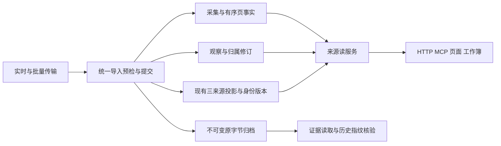

# 三来源业务完整迁移与混合表物理退役

状态：[#707 已独立静态接受](https://github.com/MangMax/ningbo-specialized-sme-platform/issues/707#issuecomment-6771581483)。接受范围仅架构与契约；运行迁移及完整退役尚未接受，按后续各票独立验收。生产切换及删除仍需最终单独批准。

代码依据为 `331345e0a264a1c654b397c82efb5caef885af2d`，tree `463f74fcc5635ec8143881c182ad645115e085eb`，分支 `integration/690-current-roster-performance`。保留 #691 请求内依赖复用、#702 单次候选枚举和 #687 资格规则。#705 JSON 物化候选未合入，其性能 FAIL 不变。ES 指 ES6+，不引入 Elasticsearch。

本提案替代 [ADR0001](0001-source-domain-boundaries.md) §2、§5、§7 的长期旧观察运行兼容选择，以及[身份 ADR](2026-10-23-platform-business-record-identity.md)的保留 query/relation 物理实体选择。[正文共享 ADR](2026-10-24-platform-archive-body-sharing.md)仍是停止实施的历史方案，本提案不恢复其 compiler、片段共享或 GC。身份、内容版本、具体观察、原始字节、原决定及未知状态的不变量继续有效。

## 选择与理由

复用 `platform_business_record`、`platform_business_record_version`、`platform_business_observation` 与三张来源投影。把采集传输、页位置和观察归属从混合业务字段中分出。完成后删除 `platform_query`、`platform_relation` 及其运行依赖，不保留兼容 view、运行选择器或旧读写后门。旧 ID 只作持久引用别名。

现有 typed 路径仍从 relation 获得企业归属，从 query 获得完整性和页范围。`platformBusinessObservation.relationId` 仍是旧 relation 外键。仅把 JSON 改为投影查询无法删表。见 [schema](../../db/postgresql/)、[业务读接缝](../../server/utils/platform-business-read.ts)、迁移前的候选实现 和 [资格见证](../../lib/roster/recognized-filter-source.ts)。

选择**同一业务 SQLite 中的不可变 BLOB 归档记录**，见存储契约。本应用已有 SQLite 事务、SQL 原字节切片及 64 KiB base64 证据接口。文件库保存可删除、可恢复、路径绑定的正式文件，`stored-files.ts` 的 `contentIdentity` 明确不能证明历史不可变内容，见[文件库实现](../../server/utils/stored-files.ts)。选择文件方案会增加跨磁盘与 DB 提交、孤儿文件和恢复协议，当前没有可复用的不可变 blob 设施。BLOB 增加数据库体积和备份成本，但允许原文、业务事实与回执在一个事务提交。本期不承诺压缩、去重或文件体积下降。

## 责任与数据流

传输结果不是业务提交。`runPlatformLiveQuery` 返回结果，批量任务保存 segments 和 unfinished 到 job.result，随后统一导入才创建 query/relation。不得让新采集页结构把“已收到”变成“已确认归属”。[实时传输](../../server/utils/platform-live-query.ts)、[批量任务](../../server/utils/platform-batch-query.ts)、[导入](../../server/utils/roster-import.ts)继续分别拥有这三件事。

来源读写模块分别拥有申报、关联办理、认定目录的字段和解析规则，不造共享 status/year/batch 字典。共用基础设施只负责事务、身份版本、归档、采集、观察与归属修订。业务 JSON 仅在导入边界解析一次；运行过滤、资格、候选、年度闭包和聚合均读结构化事实。证据接口与历史指纹核验可以按明确 owner 读取原档，不能成为业务 fallback。

未解析或冲突身份仍是观察，不进入按业务 ID 去重的集合。每个观察的来源称号类型和stored/source字段对照（包括已有verified版本的观察）落入现有各源投影的 observation-owner 分支；共享版本内容仍独立保留，无版本历史也按同源规则保留raw-only事实，不能塞回通用 observation 的 nullable 业务列。详细约束、字段与迁移见契约。

## 三种称号范围不得混同

查询 requested membership、页的实际 rdjb、行的 rdjb 是三个事实。现有 `platform_query_title_scope` 的 JSON5、text-only、二次解析和 error 标记有确定语义，重建外键并转交给 collection writer，复用这张索引表，不再建立第二份 membership 表。最终表名可保留 `platform_query_title_scope`，但列改 collection_id，FK 只能指 collection；它不构成旧 query 实体或兼容 view。

例：查询 rdjb=`2,3`，成功页依次 `(2,1行),(3,1行)`，sequence=2 无行 rdjb，不能因查询包含 2 就把该行归到 2。若行写 2 而页为 3，则保留冲突。无页历史不能凭 row title 补出完整查询范围。

迁移保留各调用者已有的判据差异。候选的 `relationTitleSql`、认定目录 row/query scope、差异决定页定位、范围证明连续完整页和年度闭包不能共用一个猜测的 effectiveTitle。先结构化其输入，再在各领域保持原规则。详见范围契约。

认定目录 normalized 值与资格保真字段继续分开。`whpcyear=false` 不是缺失；`sourceMaintenanceYearAbsent=null` 是未捕获；`" 2028 "` 不等于资格语法中的 `"2028"`。不可从 normalized projection 重造原类型或空白。无法证实的历史保留 unknown，不以丢弃记录满足完整率。

## ORM、分页和计算

常规 CRUD、JOIN、条件、groupBy、distinct、union、排序和分页优先 Drizzle。已读取本机另一个 checkout 安装的 **0.45.4** 类型，与当前 lock 版本一致。同步 `transaction` 及 behavior、BLOB buffer、集合运算均有类型定义；这只证明 API 存在，不证明本设计编译或运行通过。API 证据与例外列出确切文件和行号。

原字节 `cast/substr/length` 使用 Drizzle `sql` 表达式。SQLite PRAGMA、schema 重建和一致备份属于基础设施所有者，不能据此批准业务整段原生 SQL。需 planner hint 或特殊语法时，提交具体 API 限制与 query plan 后才登记例外，不假定复杂 CTE 无法由 ORM 表达。

业务列表先在 DB 筛选计数与稳定分页，再按本页 record/version IDs 聚合计数、归属与冲突。资格候选先完成语义判定以保持全局 counts/options，完整 evidence 仅水合选中页或导出块。年度统计保留紧凑年度汇总，只构建所选年度详情。Map/Set 适合一次遍历与稳定去重，es-toolkit 适合已验证的 groupBy/orderBy；用工具替换循环不自动更快。原 first/last winner、字符串排序、类型、null、hash serializer 都不能改变。

## 引用、迁移及终态

契约规定双向 ID 映射、原字节桶、历史 fingerprint 输入、归属修订、失败及空采集、检查点和切换协议。覆盖与分票逐项承接原 14 组及动态入口，不把历史“已切换”当作物理退役验收。

升级先在一致隔离副本执行。旧源只由 upgrade-only 工具读取；过渡版本不部署为终态。逐切片完成后，以固定源与同一 asOf 对照，再在旧表实际不存在的副本执行公开 HTTP/MCP、工作簿、重启及引用验证。最后退役触发器、FK、selectors、六个历史正文附表及两张混合表。六表为空仍只是历史前提，退役前须验证；非空则无损转存，不得直接删除。

切换前暂停新提交并排空任务、保存一致 DB 和文件备份，再迁移与验证。本次 S 离线实现将无并发写明确为维护窗口操作条件：用 SQLite backup（包含已提交 WAL）生成独立一致快照，关闭采集连接后仅从固定快照读取，写入独立 target；不承担对可写活库持续持锁的在线迁移保证，不引入 lock-owner 子进程。文件 hash、只读连接和身份核验不证明停写。已绑定旧回执的源快照保持原件，不重新备份后冒充原来源。具体步骤见 S 离线操作。切换后采用支持目标 schema 的回滚二进制；旧二进制不得打开已删表 DB。若需要恢复旧 schema，必须先验证保留切换后新提交的逆向迁移，不能用旧备份覆盖新回执。生产执行另行批准。

本次仅文档静态核对。测试、typecheck、build、迁移、DB 查询、性能、HTTP/MCP、工作簿及浏览器均 **UNRUN**。独立审查由父线程安排。仓外研究 `/Users/mang/.t3/acceptance/platform-complete-migration/` 是未审输入，新增 `a0/` 保留本轮证据指针；不提交业务数据或研究原件。

## #723 待审补充

[观察 fingerprint 原输入与生命周期](2026-11-11-observation-fingerprint-basis.md)提出专属索引证据 owner，解决 target writer 输入到存储投影多对一的问题。该补充待独立接受，不变更本 ADR 的已接受状态或整体迁移门槛，不代表 #722 已接受或已集成。
